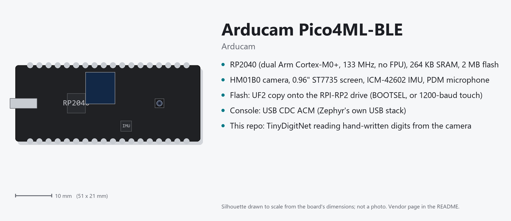
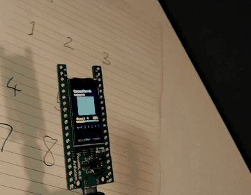
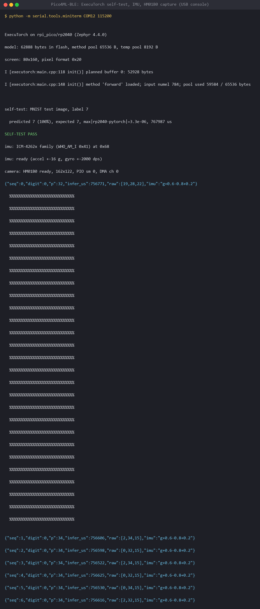

# ExecuTorch digit recognition on the Arducam Pico4ML-BLE (RP2040, Zephyr)

The Pico4ML-BLE is an RP2040 with a camera, a screen, an IMU and a microphone on one board,
which makes it a good place to see how small ExecuTorch can go: a Cortex-M0+ at 133 MHz with
no FPU and 264 KB of RAM. This repo runs the same TinyDigitNet MNIST model as my
[XIAO ESP32-S3 example](https://github.com/eoinjordan/executorch-zephyr-xiao-esp32s3) under
Zephyr with the
[ExecuTorch Zephyr module](https://docs.zephyrproject.org/latest/develop/manifest/external/executorch.html),
points the HM01B0 camera at a hand-written digit, and shows the crop, the digit and the
confidence on the 0.96" ST7735, with the IMU tilt underneath.



```
 HM01B0 ──PIO+DMA──▶ 162x122 gray ──crop/box-average──▶ 28x28 ──ExecuTorch──▶ digit, p
                                                           │                      │
 ICM-20948 ──I2C0──▶ tilt                                  └──▶ ST7735 (SPI1) ◀───┘
                                                                  USB CDC: JSON + ASCII preview
```



The screen shows the 28x28 crop the model sees, the digit, the confidence bar and the IMU
tilt; the console prints the same as JSON. Full video frame: [docs/images/board.jpg](docs/images/board.jpg).

## What is in the repo

| Piece | Where | Notes |
|---|---|---|
| Model | `train/model.py`, `train/train_mnist.py` | TinyDigitNet, ~14 k parameters, portable fp32 ops |
| Host check | `train/run_pte_host.py` | runs the `.pte` on the ExecuTorch Python runtime |
| Firmware | `firmware/` | Zephyr app for `rpi_pico` with a Pico4ML overlay |
| Camera | `firmware/src/camera.c` | HM01B0 1-bit serial capture with PIO + DMA, after Arducam's RPI-Pico-Cam |
| Screen | `firmware/src/screen.c` | ST7735S 80x160 through Zephyr's display API + MIPI-DBI, 6x8 font |
| IMU | `firmware/src/imu.c` | ICM-42602 (or ICM-20948) accel + gyro over raw I2C; Zephyr 4.4 has no driver for either |
| Flash | `firmware/scripts/flash_pico4ml.py` | 1200-baud reboot into BOOTSEL, then copies the UF2 |
| CI | `.github/workflows/build.yml` | builds the firmware for `rpi_pico` |

## Wiring (all on the board)

| Function | RP2040 pins | Zephyr |
|---|---|---|
| HM01B0 SCCB | GP4 SDA, GP5 SCL | `i2c0`, address 0x24 |
| HM01B0 control | GP2 RESET, GP3 XCLK (12.5 MHz), GP16 VSYNC | GPIO, PWM slice 1B |
| HM01B0 data | GP6 D0, GP14 PCLK, GP15 HSYNC | `pio0` state machine + DMA |
| ST7735S | GP10 SCK, GP11 MOSI, GP13 CS, GP9 DC, GP7 RST | `spi1` + `zephyr,mipi-dbi-spi` |
| IMU (ICM-42602 here, ICM-20948 per the datasheet) | GP4/GP5 (shared) | `i2c0`, address 0x68 |
| Microphone | GP26 DATA, GP27 LRCLK, GP28 BCLK | PIO I2S capture, not wired up yet |
| Console | USB | CDC ACM |

The camera pins come from Arducam's demo code; the mic pins from the community
`arducam_mic` library. The BLE module's UART is not used.

## Quick start

```bash
python3 -m venv .venv && source .venv/bin/activate
pip install -r requirements.txt --extra-index-url https://download.pytorch.org/whl/cpu
python train/train_mnist.py            # or keep the committed firmware/model/mnist_tiny.pte
python train/run_pte_host.py

west init -m https://github.com/eoinjordan/executorch-zephyr-arducam-pico4ML-BLE ws
cd ws && west update --narrow -o=--depth=1 && west packages pip --install
west sdk install --toolchains arm-zephyr-eabi
west build -p always -b rpi_pico executorch-zephyr-arducam-pico4ML-BLE/firmware
python executorch-zephyr-arducam-pico4ML-BLE/firmware/scripts/flash_pico4ml.py --uf2 build/zephyr/zephyr.uf2
```

The flash script needs no button: it opens the board's USB serial port at 1200 baud, which
both the stock Arducam firmware and this one treat as "reboot into BOOTSEL", waits for the
`RPI-RP2` drive and copies the UF2. On Windows add `pip install torch --index-url
https://download.pytorch.org/whl/cpu`, put 7-Zip on `PATH`, and pass
`-- -DFLATC_EXECUTABLE=<venv>/Scripts/flatc.exe` to `west build`.

Then open the USB serial port (any baud except 1200). This is the board on my desk:

```
ExecuTorch on rpi_pico/rp2040 (Zephyr 4.4.0)
model: 62888 bytes in flash, method pool 65536 B, temp pool 8192 B
screen: 80x160, pixel format 0x20
I [executorch:main.cpp:118 init()] planned buffer 0: 52928 bytes
I [executorch:main.cpp:148 init()] method 'forward' loaded; input numel 784; pool used 59584 / 65536 bytes

self-test: MNIST test image, label 7
  predicted 7 (100%), expected 7, max|rp2040-pytorch|=3.3e-06, 766274 us
SELF-TEST PASS
imu: ICM-4262x family (WHO_AM_I 0x41) at 0x68
imu: ready (accel +-16 g, gyro +-2000 dps)
camera: HM01B0 ready, 162x122, PIO sm 0, DMA ch 0
{"seq":0,"digit":0,"p":32,"infer_us":756771,"raw":[19,28,22],"imu":"g+0.6-0.8+0.2"}
```



`raw` is the min, max and mean of the frame before any processing: if the max stays below
about 50 the lens is covered or the room is dark, whatever the model says. Every tenth frame
the console also prints the 28x28 crop as ASCII, the quickest way to check framing without
looking at the LCD. Write a digit with a thick pen on white paper and hold it about 10 cm from
the lens under decent light; the crop is contrast-stretched and inverted before it reaches the
model, so uneven light is fine but the digit has to fill most of the crop.

The HM01B0 here sends each pixel MSB first, which is what the PIO program assumes. If your
preview looks like random noise while `raw` spans the full range, build with
`-DCONFIG_APP_CAM_BIT_REVERSE=y`.

Two things worth knowing from the first run: the inference takes about 760 ms, because a
Cortex-M0+ does fp32 in software (the same model runs in a few ms on the ESP32-S3), and the
IMU on this board answers as an ICM-42602 (WHO_AM_I 0x41), not the ICM-20948 the product
pages list, so `imu.c` probes for both families.

## Verify

1. `python train/run_pte_host.py` passes on the host.
2. The console shows `SELF-TEST PASS` and the screen shows the test digit with a green status.
3. With the camera running, the JSON lines change as you move the paper, and the ASCII preview
   looks like the digit.

## Memory

RP2040 SRAM is the constraint, not flash. The frame buffer (162 x 122 = 19.8 KB with 2x2
binning), the screen buffer (80 x 160 x 2 = 25.6 KB) and the ExecuTorch method pool (64 KB)
are the big static users. Turn binning off (`CONFIG_APP_CAM_BINNING=n`) for 324 x 244 frames
only if you shrink the pool. The boot log prints how much of the pool the model actually used.

## Roadmap

- Keyword spotting: PIO I2S capture from the on-board mic, MFCC with CMSIS-DSP, the DS-CNN
  from the [EchoGlow air monitor](https://github.com/eoinjordan/executorch-zephyr-echoglow-air-quality)
  as a second `.pte`.
- Person or face detection instead of digits: a 96x96 input and an int8 model with the
  Cortex-M (CMSIS-NN) kernels, since fp32 on an M0+ is software float.
- BLE: push the results over the on-board module.

## Further reading

- [Arducam Pico4ML](https://www.arducam.com/docs/pico/) and the
  [RPI-Pico-Cam](https://github.com/ArduCAM/RPI-Pico-Cam) capture code this borrows from.
- [Zephyr: Raspberry Pi Pico board page](https://docs.zephyrproject.org/latest/boards/raspberrypi/rpi_pico/doc/index.html)
- [ExecuTorch as a Zephyr module](https://docs.zephyrproject.org/latest/develop/manifest/external/executorch.html)

## License

Apache-2.0. See [LICENSE](LICENSE).
